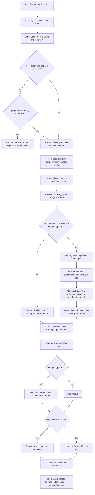
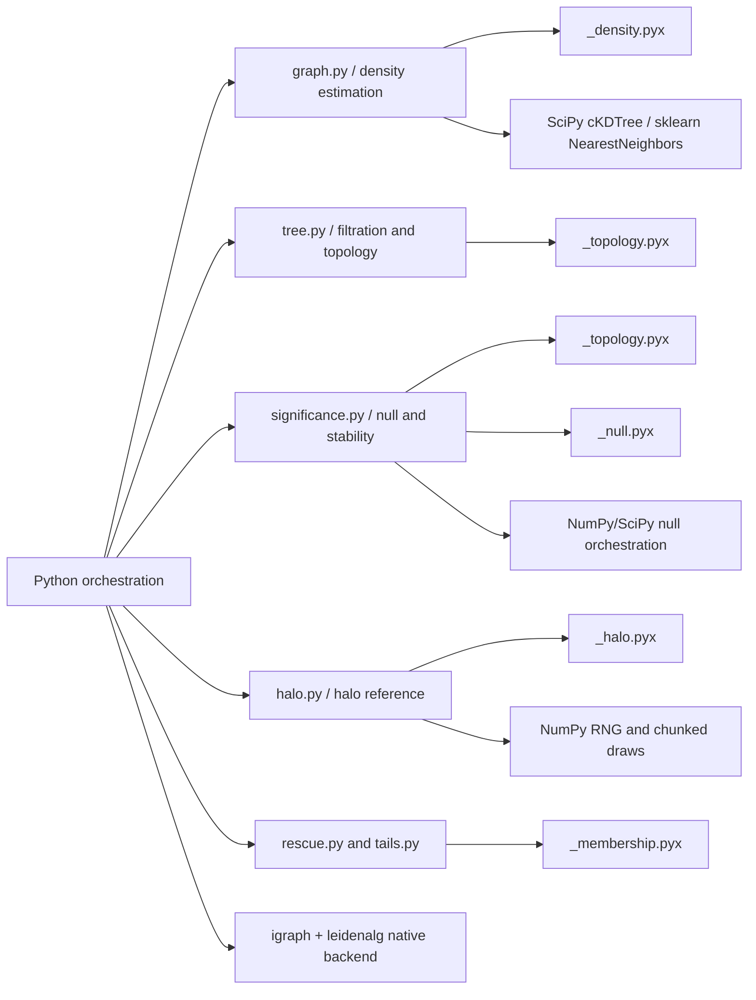

# ENTRAP 1.0.0 — Detailed Process Flowcharts

This document follows the 1.0.0 source package (`estimator.py`, `config.py`, `graph.py`, `tree.py`, `filtration.py`, `significance.py`, `stability.py`, `leiden.py`, `halo.py`, `rescue.py`, `tails.py`, and the five Cython extensions).

## 1. End-to-end estimator flow



## 2. Detailed recursive `build_tree` flow for each node

```mermaid
flowchart TD
    A[Node receives global indices S and X_node = X[S]] --> B{n < min_cluster_size?}
    B -- Yes --> C[Return leaf: not a cluster]
    B -- No --> D[Get local max-K kNN cache]
    D --> E{Root cache matches this complete node?}
    E -- Yes --> F[Reuse cached neighbors]
    E -- No --> G[Build fresh local kNN graph on X_node]
    F --> H[Estimate local density]
    G --> H
    H --> I{adaptive_k or normalized_density?}
    I -- Yes --> J[Estimate intrinsic dimension d_hat with TwoNN]
    I -- No --> K[No d_hat required]
    J --> L[Choose local K_i from each neighbor-distance curve]
    K --> L
    L --> M[Calculate per-point density and K-bias correction]
    M --> N[Separately calculate fixed-K halo log-density]
    N --> O[Resolve feasible graph scale family K_scales for n]
    O --> P{Any feasible K >= 2?}
    P -- No --> C
    P -- Yes --> Q{tau_null = poisson?}
    Q -- Yes --> R[Observed multi-K graph statistics]
    R --> R1{Cython topology available?}
    R1 -- Yes --> R2[_topology: one fused pass over all K; prominence + component counts]
    R1 -- No --> R3[For each K: graph -> filtration -> merge tree -> stats]
    Q -- No --> S[For each K: graph -> filtration -> merge tree -> observed prominence/components]
    S --> S1[Estimate block scale; _null Cython CSR BFS when compiled]
    S1 --> S2[Block-permutation null per K; family alpha/M]
    R2 --> T[Poisson multi-scale null calibration]
    R3 --> T
    T --> T1[For each of P null clouds: query neighbors once at max required K]
    T1 --> T2[Apply same density rule and evaluate all graph K scales]
    T2 --> T3[Store null maximum prominence and connected-component counts]
    T3 --> T4[Thresholds at upper quantile 1 - alpha/(2M)]
    T4 --> U[Compute p_prom and p_components per K]
    U --> U1[p_scale = min(1, 2 * min(p_prom, p_components))]
    U1 --> U2[p_adjusted = min(1, M * min(p_scale))]
    U2 --> U3[Score each K: max(prominence/tau, components/component_threshold)]
    U3 --> U4[Select K by smallest p_scale; break ties by highest score]
    S2 --> V[Select K with highest prominence/tau score]
    U4 --> W[Build/materialize full merge tree only at selected K]
    V --> W
    W --> W1[Release unselected K temporaries and local max-K neighbor cache]
    W1 --> X[Compute topological mode-count support]
    X --> Y{Poisson and topological_count <= 0?}
    Y -- Yes --> Z[Set m_star=0; skip internal stability]
    Y -- No --> AA{Internal stability enabled?}
    AA -- No --> AB[Use selected-tree persistence count, capped by topological support]
    AA -- Yes --> AC{Poisson and topological_count >= 2?}
    AC -- Yes --> AD[Multi-K stability: B subsamples]
    AC -- No --> AE[Selected-K mode-count stability]
    AD --> AD1[Each subsample rebuilds local kNN and adaptive density]
    AD1 --> AD2[Recompute observed persistence/components for every feasible K]
    AD2 --> AD3[Re-select K using parent-calibrated null family]
    AD3 --> AD4[Count modes at selected K]
    AD4 --> AD5[Aggregate stable mode count at confidence 1-alpha]
    AD5 --> AF[Cap m_star by full-data topological_count]
    AE --> AF
    AB --> AG[Set node.m_star]
    AF --> AG
    Z --> AG
    AG --> AH{m_star <= 1?}
    AH -- Yes --> AI[Mark node leaf]
    AI --> AJ{m_star=1, n>=min_cluster_size, and significance supported?}
    AJ -- No --> AK[Return non-cluster leaf]
    AJ -- Yes --> AL[Accept cluster leaf; estimate halo/core mask]
    AL --> AM[Return accepted leaf with core indices]
    AH -- No: m_star >= 2 --> AN[Split persistence tree at tau_split; assign merge-tree seed]
    AN --> AO[Leiden CPM scan on same undirected simple graph]
    AO --> AP{Leiden finds exact target community count?}
    AP -- Yes --> AQ[Use optimised Leiden partition]
    AP -- No --> AR[Keep merge-tree seed and record fallback diagnostic]
    AQ --> AS[For each community, create child index set]
    AR --> AS
    AS --> AT[Recurse: rebuild child-local kNN and repeat this flow]
```

### 2a. Mathematical details used inside each node

**Resolved graph-scale family.** Unless explicitly supplied, a legacy K anchor is `min(50, max(15, ceil(2 ln N)))`. The default candidate graph scales are rounded fractions `(0.28, 0.42, 0.60, 0.80, 1.00)` of that anchor, clipped to the node's feasible `n-1`. `adaptive_k_max` controls the separate density-neighborhood cache; it is not the graph K.

**Adaptive density.** For each point, Cython `_density.pyx` inspects the slope of `log(r_k)` against `log(k)` and applies the configured sensitivity, window, and patience rule to select local `K_i`. The default inverse-mean-radius density is based on `1 / mean(r_1,...,r_Ki)` with the configured Gamma-moment correction when K varies. In normalized mode it uses the kNN-volume estimator with the `(K_i-1)` correction. SciPy remains responsible for kNN search and Gamma functions.

**Filtration.** Vertex level is `ell_i = log(rho_i)`. With mutual reachability OFF, graph edges connect vertex filtration levels. With it ON, edge level is `ell_ij = min(ell_i, ell_j, -log(d_ij))`. Persistent homology and merge-tree operations are executed through `_topology.pyx` when compiled.

**Poisson null.** Each null realization is drawn in the observed axis-aligned feature box (or a unit cube when `tau_null_dim` is explicitly specified), queried once at the maximum required neighborhood, and reused over all graph K scales. Prominence and component-count thresholds each use tail probability `alpha/(2M)`. The empirical p-values use the plus-one correction `(1 + exceedances)/(P + 1)`.

**Multi-scale selection.** For each K: `p_scale = min(1, 2 min(p_prominence, p_components))`; family adjustment is `p_adjusted = min(1, M * min_K(p_scale))`. K is selected by minimum scale p-value, with the normalized score as tie-breaker.

**Internal stability.** For split proposals (`topological_count >= 2`), each subsample re-estimates its local neighbors/density, reevaluates feasible K values, and reselects K. Parent-calibrated null prominence and component evidence are reused; component observations are recomputed on the subsample. For a one-mode node, stability is evaluated at the selected K only. `m_star` is capped by full-data topological support.

**Leiden.** The merge-tree assignment at `tau_split` is the seed. `leidenalg` optimizes `CPMVertexPartition` on an undirected, simple igraph graph. Candidate gamma values are scanned deterministically (log-spaced values plus values around the seed's internal edge density); restarts/iterations follow config. A partition is accepted only if it has exactly `m_star` communities. Otherwise the merge-tree seed is retained and the fallback is recorded. Each child then rebuilds its own kNN graph.

## 3. Cython / native execution map



| Module | Native work actually handled | What remains in Python / external native libraries |
|---|---|---|
| `_topology.pyx` | kNN edge/CSR conversion, edge filtration fields, multi-K graph statistics, union-find, persistence/merge-tree kernels | Recursive control flow and node orchestration remain in Python |
| `_density.pyx` | Per-point adaptive K selection and fused density calculation | kNN queries use SciPy; Gamma functions use SciPy; Python wrapper retains reference fallback |
| `_null.pyx` | CSR breadth-first traversal and online correlation moments for block-scale estimation | Used by the block-permutation null path; random source selection and permutation orchestration remain in Python |
| `_halo.pyx` | Transform exponential increments into Poisson reference statistics; variable-K fused loop | NumPy RNG supplies draws; fixed-K path deliberately uses vectorized NumPy operations in chunks |
| `_membership.pyx` | Mahalanobis candidate assignment and synchronous tail-neighbor propagation | Gaussian mean/covariance fitting, cKDTree neighbor query, eigendecomposition and geometric mask remain NumPy/SciPy |
| Leiden backend | Not an ENTRAP Cython module | `igraph` constructs graph; `leidenalg` performs CPM optimization in its native implementation |

## 4. Important output distinctions

- `core_labels_`: labels after pointwise stability filtering, before rescue.
- `labels_`: final labels after stability filtering and optional rescue/tail extension.
- `tail_mask_` / `tail_labels_`: geometric tail candidates only; not astrophysical confirmation.
- `pi`: point-level membership stability; `pi_pc`: point-by-reference-cluster probabilities.
- `leiden_diagnostics_`: counts and per-node records of Leiden calls, attempts, accepted optimizations, and seed fallbacks.
- `result_`: result object with labels, probabilities, stats, root tree, resolved config and tracker.

## 5. Configuration defaults relevant to the flow

The source defaults include `adaptive_k=True`, `multi_k=True`, `mutual_reachability=False`, `tau_null="poisson"`, `use_leiden=True`, `allow_fallback=False`, `compute_pi=True`, and `tail_membership=False`. The demo may override these values. The resolved K family depends on N and any explicit `k`/`k_scales` options.
